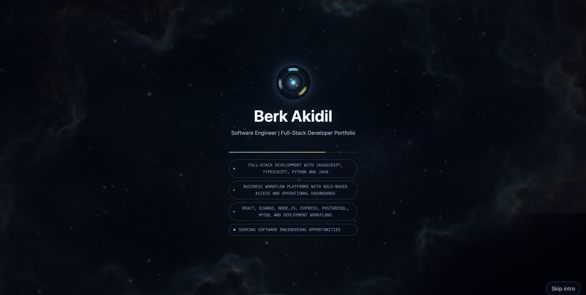
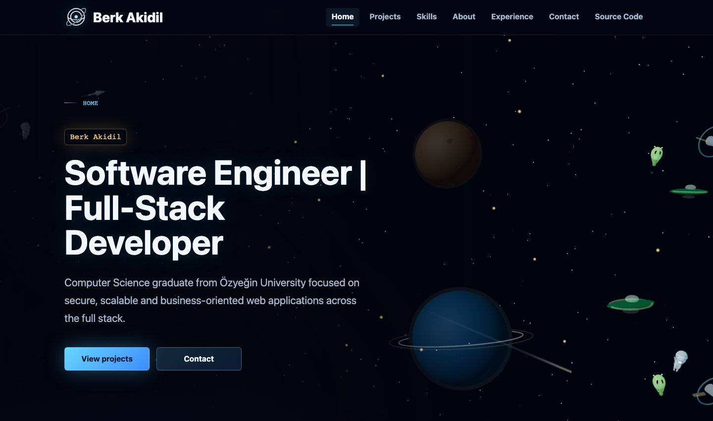
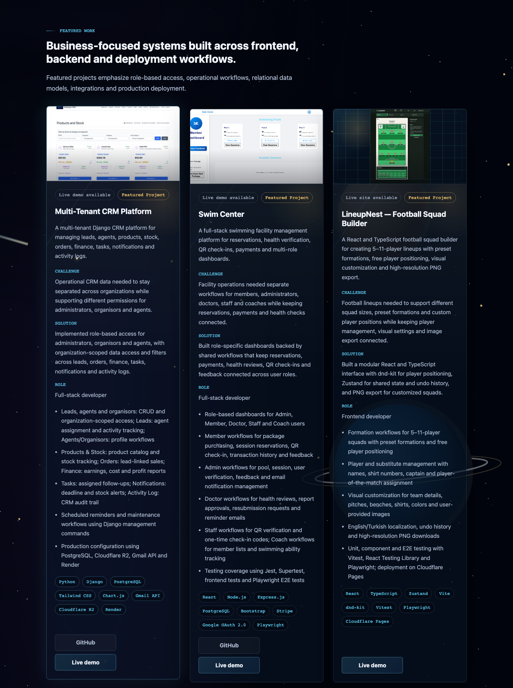

# Berk Akidil Portfolio

A personal software engineering portfolio built with React, JavaScript, Vite
and Three.js. It presents featured projects, skills, background, experience,
contact links and a space-themed visual experience.

Live site: [berkakidil.vercel.app](https://berkakidil.vercel.app/)



## Features

- Detailed project showcases with challenges, solutions, developer roles, technology stacks and expandable screenshots.
- Responsive single-page navigation across desktop and mobile.
- Interactive 3D space visuals, a skippable launch intro and scroll-triggered animations.
- Reduced-motion support and a static fallback when 3D rendering is unavailable.

## Screenshots

**Home**



**Project showcases**



## Tech Stack

| Area | Tools |
| --- | --- |
| Application | React, JavaScript, Vite |
| Visuals | Three.js, React Three Fiber, Drei, Framer Motion |
| Styles | CSS Modules and shared CSS tokens |
| Quality checks | ESLint |
| Behavior tests | Playwright |

## Getting Started

Prerequisites: Git, Node.js and npm. Node.js 24 is recommended.

```bash
git clone https://github.com/BerkAkidil9/portfolio.git
cd portfolio
npm ci
npm run dev
```

Open the local URL printed by Vite. No `.env` configuration is required.

## Commands

| Command | Purpose |
| --- | --- |
| `npm run dev` | Start the Vite development server. |
| `npm run build` | Create the production build in `dist/`. |
| `npm run preview` | Serve `dist/` locally after running `npm run build`. |
| `npm run lint` | Check code with ESLint. |
| `npm run test:e2e` | Build the site and run the Playwright behavior tests. |

## Behavior Tests

The [Playwright tests](e2e/) check navigation, screenshot previews, outgoing links,
the resume PDF, launch intro and reduced-motion behavior in desktop and mobile
Chromium. They also check for uncaught JavaScript errors. External link
destinations are mocked to keep tests independent of third-party availability.

Install Chromium, then run the browser tests. Repeat the installation after updating Playwright:

```bash
npm exec -- playwright install chromium
npm run test:e2e
```

The test command builds the site and starts the preview server automatically.
View the HTML report with `npm exec -- playwright show-report`. Failure
screenshots and traces are saved in `test-results/`.

## Project Structure

| Path | Responsibility |
| --- | --- |
| `src/data/` | Profile, projects, skills, experience, links and SEO values. |
| `src/components/` | Navigation, layout, page sections and reusable UI. |
| `src/experience/` | Three.js scene and visual fallback. |
| `src/styles/` | Shared styles and design tokens. |
| `public/` | Project images, videos, icons, Open Graph image and PDF resume. |
| `e2e/`, `playwright.config.js` | Browser tests and configuration. |
| `index.html` | Initial page metadata. |

## Content Updates

Update portfolio content in `src/data/` and keep image and resume links aligned
with the files in `public/`.

SEO values in `src/data/portfolio.js` are applied when the app loads. Keep the
matching metadata in `index.html` synchronized.

## Deployment

Hosted on Vercel from `main`. For static hosting, use `npm run build` as the build
command and `dist/` as the output directory.

The current setup assumes hosting at the domain root. Subpath deployments require
adjusting the Vite base configuration and public asset URLs.

## Help and Contributions

Maintained by [Berk Akidil](https://github.com/BerkAkidil9).

For bugs or suggestions, [open an issue](https://github.com/BerkAkidil9/portfolio/issues).
Pull requests are welcome; run `npm run lint` and `npm run test:e2e` before
submitting code changes.

## License

This project is open source under the MIT License. See [LICENSE](LICENSE).
